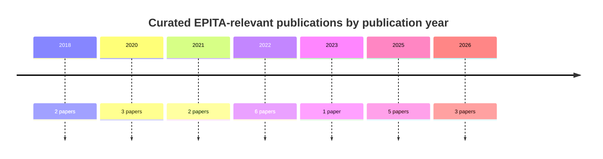

# Curated literature for the EPITA hybrid MPC–RL research plan

## Executive summary

I curated **22 peer-reviewed publications from 2018–2026** that map closely to the proposed EPITA project, with emphasis on work that helps answer the proposal’s central scientific question: **which responsibilities should remain with constrained/model-based MPC, which should be learned by RL, and how should those layers be distributed across heterogeneous local resources and an aggregate community controller?** The set therefore deliberately combines foundational learning-based/safe-MPC theory with building and microgrid applications, distributed/hierarchical coordination, aggregate flexibility-region methods, MARL/federated learning, privacy/safety, and community fairness. This matches the EPITA plan’s three contemplated architectures—MPC-led, RL-led with MPC correction, and hierarchical RL plus distributed MPC—as well as its stated need to convert uncertain participant flexibility into a conservative grid-facing service with power, energy, ramp, duration, confidence, tracking, and recovery characteristics. fileciteturn0file0 Particularly close matches are Arroyo et al.’s building RL–MPC formulation, Hajialigol et al.’s hierarchical building-cluster RL–MPC architecture, Locher et al.’s RL-value-function/MPC battery controller, Bay et al.’s distributed grid-interactive building MPC, Riaz and Mancarella’s flexibility-envelope characterization, and Crowley et al.’s community-to-grid-service mechanism. citeturn21search0turn3search0turn31search0turn31search2turn32search2turn33search1 **No MDPI publication or IEEE Access article is included.** The complete, Zotero-importable BibTeX library is available as a file here: **[Download the curated EPITA BibTeX library](sandbox:/mnt/data/epita_relevant_literature.bib)**.

## Mapping to the EPITA research plan

The selection was driven by the research architecture rather than simply searching for papers containing “reinforcement learning” and “energy.” In the EPITA plan, the proposed community contains heterogeneous buildings, PV, local/shared batteries and flexible loads; the coordinator must balance internal self-consumption/cost/comfort objectives against an externally dependable flexibility service. Figure 4 on page 7 makes an important architectural distinction between the **physical power network** and the **digital coordination/market interface**, while page 8 proposes three specific MPC–RL coupling patterns: MPC-led learning of residuals/model corrections/parameters/terminal values; RL-led proposals corrected by MPC; and hierarchical slower RL coordination with faster distributed MPC. fileciteturn0file0

That makes the first six papers in the collection especially important methodologically. Hewing et al. organize learning-based MPC into learning the dynamics, learning MPC design components, and using MPC to safeguard learning controllers; Gros and Zanon show how economic NMPC itself can serve as the RL function approximator; Zanon and Gros develop the robust-MPC/safe-RL connection; Wabersich and Zeilinger formalize the predictive-safety-filter pattern; Wabersich et al. extend this toward probabilistic safety certification; and Rosolia and Borrelli show how terminal information can be learned from experience while retaining MPC feasibility properties. Together, these papers provide a much stronger theoretical basis for deciding **what RL should learn** than treating RL merely as an alternative controller. citeturn26search0turn30search0turn28search2turn29search0turn30search4turn30search5

The most direct applied precedents then cover complementary versions of the architecture. Arroyo et al. explicitly merge RL and MPC in building management and benchmark both methods on the same control problem. citeturn21search0 Hajialigol et al. are even closer to the proposed EPITA hierarchy: local MPC handles HVAC while centralized soft actor-critic coordination manages higher-level/storage behavior across a cluster of buildings. citeturn3search0 Locher, Stai and Hug insert an RL-learned value function into MPC for constrained real-time battery control, a particularly relevant precedent for learning a terminal/long-horizon value while leaving short-horizon feasibility with MPC. citeturn31search0 CommonPower is important for a different reason: it combines symbolic energy-system models, robust MPC, RL safeguarding, MARL and heterogeneous controller structures in a reusable research framework, making it an unusually useful comparator when positioning Open Energy Lab scientifically. citeturn25search3turn25search2

For distributed coordination, Bay et al. show heterogeneous buildings following an aggregate grid reference while preserving local objectives using limited-communication DMPC; Clarke et al. demonstrate hierarchical economic MPC experimentally on a PV–battery–generator microgrid; Jendoubi and Bouffard explore hierarchical MARL and centralized-training/decentralized-execution approaches; and Morstyn et al., already cited by the EPITA proposal, provide the broader distributed-storage control foundation. citeturn31search2turn31search3turn31search8 fileciteturn0file0

Finally, the aggregate-service side of the project needs literature beyond controller design. Riaz and Mancarella characterize DER flexibility through operating envelopes containing **capacity, ramp, duration and cost**, which is exceptionally close to the proposed flexibility contract. citeturn32search2 Wen et al. derive exact and approximate aggregate feasible regions for heterogeneous DERs. citeturn32search1 Thrän et al. go one step closer to reserve participation by aggregating uncertain EVs into power/energy boundaries and scheduling reserve using stochastic MPC. citeturn32search0 The federated/privacy papers address what information should remain local, while the collective-self-consumption papers address the EPITA proposal’s requirement to expose how benefits and burdens are distributed internally rather than optimizing only the aggregate. citeturn33search2turn33search0turn33search7turn33search1

## Curated publication table

| Key | Publication | Authors | Year | Venue | Relevance tags | Reason for inclusion |
|---|---|---|---:|---|---|---|
| `Hewing2020LearningBasedMPC` | **Learning-Based Model Predictive Control: Toward Safe Learning in Control** citeturn26search0 | Lukas Hewing; Kim P. Wabersich; Marcel Menner; Melanie N. Zeilinger | 2020 | *Annual Review of Control, Robotics, and Autonomous Systems* | MPC–RL, robustness | The best conceptual starting point for deciding whether learning should modify models, MPC parameters/value terms, or sit outside MPC behind a safety layer. |
| `GrosZanon2020DataDrivenENMPC` | **Data-Driven Economic NMPC Using Reinforcement Learning** citeturn30search0turn30academia36 | Sébastien Gros; Mario Zanon | 2020 | *IEEE Transactions on Automatic Control* | MPC–RL, robustness | Gives a foundational MPC-as-RL-function-approximator formulation in which RL adapts an economic MPC despite model mismatch. |
| `ZanonGros2021SafeRLMPC` | **Safe Reinforcement Learning Using Robust MPC** citeturn28search2 | Mario Zanon; Sébastien Gros | 2021 | *IEEE Transactions on Automatic Control* | MPC–RL, robustness | Directly supports an architecture in which RL optimizes performance while robust MPC is responsible for safe/feasible behavior. |
| `WabersichZeilinger2021PredictiveSafetyFilter` | **A Predictive Safety Filter for Learning-Based Control of Constrained Nonlinear Dynamical Systems** citeturn29search0turn29academia46 | Kim Peter Wabersich; Melanie N. Zeilinger | 2021 | *Automatica* | MPC–RL, robustness | Canonical theoretical precedent for the EPITA plan’s RL-led option in which MPC corrects a learned action before execution. |
| `WabersichEtAl2022ProbabilisticSafety` | **Probabilistic Model Predictive Safety Certification for Learning-Based Control** citeturn30search4 | Kim Peter Wabersich; Lukas Hewing; Andrea Carron; Melanie N. Zeilinger | 2022 | *IEEE Transactions on Automatic Control* | MPC–RL, robustness | Adds uncertainty and probabilistic safety certification, relevant to confidence-qualified flexibility and non-delivery risk. |
| `RosoliaBorrelli2018LearningMPC` | **Learning Model Predictive Control for Iterative Tasks: A Data-Driven Control Framework** citeturn30search5turn30search2 | Ugo Rosolia; Francesco Borrelli | 2018 | *IEEE Transactions on Automatic Control* | MPC–RL, robustness | Provides theory for learning terminal safe sets/value information from experience while maintaining the constrained MPC structure. |
| `ArroyoEtAl2022RLMPCBuildings` | **Reinforced Model Predictive Control (RL-MPC) for Building Energy Management** citeturn21search0 | Javier Arroyo; Carlo Manna; Fred Spiessens; Lieve Helsen | 2022 | *Applied Energy* | MPC–RL, buildings, robustness | One of the cleanest direct comparisons and combinations of RL and MPC for the same building-energy control problem. |
| `HajialigolEtAl2026HierarchicalRLMPC` | **A Hierarchical Energy Management System for a Cluster of Buildings: Reinforcement Learning and Model Predictive Control (RL-MPC) Approach** citeturn3search0 | Parisa Hajialigol; Panayiotis Papadopoulos; Amin Moazami; Mohammadreza Aghaei | 2026 | *Energy and Buildings* | MPC–RL, hierarchical, buildings, aggregation | The closest published architecture found to EPITA’s slower aggregate RL plus faster local MPC hypothesis. |
| `LocherEtAl2026SafeBatteryRLMPC` | **A Safe Combined Reinforcement Learning and Model Predictive Control Scheme for Utility-Level Battery Control in Distribution Grids** citeturn31search0turn31search7 | Leon Locher; Eleni Stai; Gabriela Hug | 2026 | *IEEE Transactions on Smart Grid* | MPC–RL, microgrid, robustness | Demonstrates RL-learned long-horizon value embedded in MPC while MPC handles near-term battery constraints. |
| `EichelbeckEtAl2026CommonPower` | **CommonPower: A Framework for Safe Data-Driven Smart Grid Control** citeturn25search3turn25search2 | Michael Eichelbeck; Hannah Markgraf; Matthias Althoff | 2026 | *IEEE Transactions on Smart Grid* | MPC–RL, distributed, MARL, microgrid, robustness, aggregation | Scientifically important for OEL positioning because it unifies robust MPC, safeguards, RL/MARL, forecasting and heterogeneous control architectures in a reusable framework. |
| `JendoubiBouffard2023HierarchicalMARL` | **Multi-Agent Hierarchical Reinforcement Learning for Energy Management** citeturn31search8turn31search12 | Imen Jendoubi; François Bouffard | 2023 | *Applied Energy* | hierarchical, distributed, microgrid, MARL | Provides a strong pure-learning hierarchical/MARL baseline against which hybrid MPC–RL architectures can be evaluated. |
| `MorstynEtAl2018DistributedStorageControl` | **Control Strategies for Microgrids With Distributed Energy Storage Systems: An Overview** fileciteturn0file0 | Thomas Morstyn; Branislav Hredzak; Vassilios G. Agelidis | 2018 | *IEEE Transactions on Smart Grid* | hierarchical, distributed, microgrid, aggregation | Establishes why distributed storage assets with separate states and constraints should not simply be modeled as one centralized battery. |
| `BayEtAl2022DistributedMPCBuildings` | **Distributed Model Predictive Control for Coordinated, Grid-Interactive Buildings** citeturn31search2turn31search5 | Christopher Bay; Rohit Chintala; Venkatesh Chinde; Jennifer King | 2022 | *Applied Energy* | hierarchical, distributed, buildings, aggregation | Tracks an aggregate grid power reference across heterogeneous buildings while retaining local comfort objectives and limited communication. |
| `ClarkeEtAl2020HierarchicalEconomicMPC` | **Control of an Isolated Microgrid Using Hierarchical Economic Model Predictive Control** citeturn31search3turn31search4 | Will C. Clarke; Michael J. Brear; Chris Manzie | 2020 | *Applied Energy* | hierarchical, distributed, microgrid, robustness | Supplies an experimentally demonstrated hierarchical MPC baseline that helps isolate the incremental benefit of adding RL. |
| `RiazMancarella2022FlexibilityCharacterisation` | **Modelling and Characterisation of Flexibility From Distributed Energy Resources** citeturn32search2turn32academia48 | Shariq Riaz; Pierluigi Mancarella | 2022 | *IEEE Transactions on Power Systems* | distributed, robustness, aggregation | Capacity, ramp, duration and cost operating envelopes map almost directly onto EPITA’s proposed firm flexibility-service descriptor. |
| `WenEtAl2022AggregateFeasibleRegion` | **Aggregate Feasible Region of DERs: Exact Formulation and Approximate Models** citeturn32search1turn32search13 | Yilin Wen; Zechun Hu; Shi You; Xiaoyu Duan | 2022 | *IEEE Transactions on Smart Grid* | distributed, robustness, aggregation | Gives mathematical tools for compressing many heterogeneous DER constraints into a usable aggregate feasible region. |
| `ThranEtAl2025EVReserveAggregation` | **Reserve Provision From Electric Vehicles: Aggregate Boundaries and Stochastic Model Predictive Control** citeturn32search0turn32search5 | Jacob Thrän; Jakub Mareček; Robert N. Shorten; Timothy C. Green | 2025 | *IEEE Transactions on Power Systems* | MPC–RL, robustness, aggregation | A particularly useful analogue for turning uncertain distributed availability into aggregate power/energy boundaries and then a reserve commitment. |
| `YangEtAl2025PersonalizedFederatedRL` | **Cooperative Optimal Dispatch of Multi-Microgrids for Low Carbon Economy Based on Personalized Federated Reinforcement Learning** citeturn33search2turn33search4 | Ting Yang; Zheming Xu; Shijie Ji; Guoliang Liu; Xinhong Li; Haibo Kong | 2025 | *Applied Energy* | distributed, microgrid, MARL, robustness | Directly addresses heterogeneous microgrids, privacy-preserving federated knowledge sharing and transfer/cold-start behavior for new participants. |
| `DengEtAl2025PrivacySafeLEC` | **Privacy-Enhanced Safe Reinforcement Learning for the Dispatch of a Local Energy Community** citeturn33search0turn33search10 | Haoyuan Deng; Ning Zhang; Yi Wang | 2025 | *IEEE Transactions on Smart Grid* | distributed, MARL, robustness, aggregation | Directly addresses EPITA’s question about what information must be shared by combining concealed local state information with RL and a safety module. |
| `GjorgievskiEtAl2022VirtualNetBilling` | **Virtual Net-Billing: A Fair Energy Sharing Method for Collective Self-Consumption** citeturn33search7turn33search5 | Vladimir Z. Gjorgievski; Snezana Cundeva; Natasa Markovska; George E. Georghiou | 2022 | *Energy* | distributed, fairness, aggregation | Highly relevant to the French collective-self-consumption framing because it explicitly treats scalable and fair internal energy allocation. |
| `CrowleyEtAl2025CommunityGridServices` | **How Can Energy Communities Provide Grid Services? A Dynamic Pricing Mechanism With Budget Balance, Individual Rationality, and Fair Allocation** citeturn33search1turn33search3 | Bennevis Crowley; Jalal Kazempour; Lesia Mitridati | 2025 | *Applied Energy* | distributed, fairness, aggregation | Bridges internal prosumer coordination and an external grid service while explicitly considering budget balance, individual rationality and fair benefit allocation. |
| `NweyeEtAl2025CityLearnV2` | **CityLearn v2: Energy-Flexible, Resilient, Occupant-Centric, and Carbon-Aware Management of Grid-Interactive Communities** citeturn9search2turn9search9 | Kingsley Nweye; Kathryn Kaspar; Giacomo Buscemi; Tiago Fonseca; Giuseppe Pinto; Dipanjan Ghose; Satvik Duddukuru; Pavani Pratapa; Han Li; Javad Mohammadi; Luis Lino Ferreira; Tianzhen Hong; Mohamed Ouf; Alfonso Capozzoli; Zoltan Nagy | 2025 | *Journal of Building Performance Simulation* | buildings, MARL, robustness, aggregation | Provides an external community-scale benchmark that is valuable for comparing OEL results and designing held-out heterogeneous-community experiments. |

A useful reading order is therefore **Hewing → Gros/Zanon → Wabersich/Zeilinger → Arroyo → Hajialigol → Locher** for the MPC–RL methodology; **Morstyn → Bay → Clarke → Jendoubi** for distributed/hierarchical architecture; **Riaz/Mancarella → Wen → Thrän** for aggregate flexibility; and **Yang → Deng → Gjorgievski → Crowley** for privacy, federation and community allocation. This ordering follows the scientific dependencies of the EPITA design rather than publication date. citeturn26search0turn30search0turn29search0turn21search0turn3search0turn31search0turn32search2turn32search1turn32search0turn33search2turn33search0turn33search7turn33search1

## Publication distribution

The collection is intentionally weighted toward *Applied Energy*, *IEEE Transactions on Smart Grid*, *IEEE Transactions on Automatic Control*, and *IEEE Transactions on Power Systems*, because those venues jointly cover the application, control-theoretic, grid-aggregation and market-facing aspects of the EPITA problem. The 2025–2026 papers are particularly useful because they show that explicit safe RL–MPC, hierarchical RL–MPC, federated dispatch, privacy-preserving community RL and grid-service community coordination are now appearing in archival power/energy journals rather than only as preliminary preprints. citeturn31search0turn25search3turn3search0turn33search2turn33search0turn33search1



```text
Venue                                              Papers
Applied Energy                                    ██████  6
IEEE Transactions on Smart Grid                   █████   5
IEEE Transactions on Automatic Control            ████    4
IEEE Transactions on Power Systems                ██      2
Automatica                                         █       1
Energy and Buildings                              █       1
Energy                                             █       1
Annual Review of Control, Robotics & Aut. Systems █       1
Journal of Building Performance Simulation        █       1
                                                   ─────────
Total                                                      22
```

The distribution also reveals a potentially valuable **research gap** for the EPITA manuscript: there is substantial literature on each component separately—safe MPC–RL, distributed building/MG control, aggregate flexibility, MARL/federation, and fair community coordination—but comparatively little archival work that combines **all five** into one heterogeneous community that must produce a firm, confidence-qualified external flexibility product. The Hajialigol architecture comes closest on hierarchical RL–MPC for a building cluster, whereas Riaz/Mancarella and Thrän et al. are closer on service characterization and dependable aggregation; Crowley et al. are closer on the community-to-grid institutional interface. That gap is an inference from the literature set rather than a claim that no such paper exists. citeturn3search0turn32search2turn32search0turn33search1

## BibTeX library

**[Download `epita_relevant_literature.bib`](sandbox:/mnt/data/epita_relevant_literature.bib)**

The file contains **22 entries** and was structurally checked for balanced braces and the presence of `author`, `title`, `journal`, `year`, `pages`, `doi`, `url`, and `abstract` in every entry. Where a legitimate public full text was identified, I also included a `pdf` field and, for arXiv versions, `eprint`/`archivePrefix`. The `abstract` fields below are **concise curator-written paraphrases of each paper’s contribution**, not copied publisher abstracts; this keeps the BibTeX useful in Zotero while avoiding the unnecessary reproduction of copyrighted abstract text. Publisher DOI URLs remain the canonical `url` field, while open PDFs are supplemental.

```bibtex
@article{Hewing2020LearningBasedMPC,
  author = {Lukas Hewing and Kim P. Wabersich and Marcel Menner and Melanie N. Zeilinger},
  title = {Learning-Based Model Predictive Control: Toward Safe Learning in Control},
  journal = {Annual Review of Control, Robotics, and Autonomous Systems},
  year = {2020},
  volume = {3},
  pages = {269--296},
  doi = {10.1146/annurev-control-090419-075625},
  url = {https://doi.org/10.1146/annurev-control-090419-075625},
  abstract = {Reviews learning-based model predictive control through three complementary roles: learning system dynamics, learning controller design parameters, and using MPC to provide safety and constraint satisfaction for learning-based controllers. It is a useful theoretical map for deciding what the MPC layer should guarantee and what the learning layer should adapt in a hybrid controller.},
  keywords = {MPC-RL, robustness, safe learning, learning-based control}
}

@article{GrosZanon2020DataDrivenENMPC,
  author = {S{\'e}bastien Gros and Mario Zanon},
  title = {Data-Driven Economic {NMPC} Using Reinforcement Learning},
  journal = {IEEE Transactions on Automatic Control},
  year = {2020},
  volume = {65},
  number = {2},
  pages = {636--648},
  doi = {10.1109/TAC.2019.2913768},
  url = {https://doi.org/10.1109/TAC.2019.2913768},
  pdf = {https://arxiv.org/pdf/1904.04152},
  eprint = {1904.04152},
  archivePrefix = {arXiv},
  abstract = {Shows how an economic nonlinear MPC scheme can act as a function approximator inside reinforcement learning and can be tuned toward the optimal policy even when its internal model is imperfect. The paper gives a foundational formulation for assigning hard constrained optimization to MPC while using RL to adapt MPC parameters for performance.},
  keywords = {MPC-RL, robustness, economic MPC, reinforcement learning}
}

@article{ZanonGros2021SafeRLMPC,
  author = {Mario Zanon and S{\'e}bastien Gros},
  title = {Safe Reinforcement Learning Using Robust {MPC}},
  journal = {IEEE Transactions on Automatic Control},
  year = {2021},
  volume = {66},
  number = {8},
  pages = {3638--3652},
  doi = {10.1109/TAC.2020.3024161},
  url = {https://doi.org/10.1109/TAC.2020.3024161},
  abstract = {Develops a safe reinforcement-learning architecture based on robust model predictive control, separating performance learning from model-based enforcement of constraints. It directly supports the EPITA question of whether an RL policy should propose or tune decisions while an MPC layer maintains physical feasibility and robustness.},
  keywords = {MPC-RL, robustness, safe reinforcement learning, robust MPC}
}

@article{WabersichZeilinger2021PredictiveSafetyFilter,
  author = {Kim Peter Wabersich and Melanie N. Zeilinger},
  title = {A Predictive Safety Filter for Learning-Based Control of Constrained Nonlinear Dynamical Systems},
  journal = {Automatica},
  year = {2021},
  volume = {129},
  pages = {109597},
  doi = {10.1016/j.automatica.2021.109597},
  url = {https://doi.org/10.1016/j.automatica.2021.109597},
  pdf = {https://arxiv.org/pdf/1812.05506},
  eprint = {1812.05506},
  archivePrefix = {arXiv},
  abstract = {Introduces a predictive safety filter that checks a learning controller's proposed action and modifies it when required to preserve constraint satisfaction using an MPC-based safety policy. This is a canonical reference for an RL-led architecture in which model-based optimization corrects actions before execution.},
  keywords = {MPC-RL, robustness, safety filter, constrained control}
}

@article{WabersichEtAl2022ProbabilisticSafety,
  author = {Kim Peter Wabersich and Lukas Hewing and Andrea Carron and Melanie N. Zeilinger},
  title = {Probabilistic Model Predictive Safety Certification for Learning-Based Control},
  journal = {IEEE Transactions on Automatic Control},
  year = {2022},
  volume = {67},
  number = {1},
  pages = {176--188},
  doi = {10.1109/TAC.2021.3049335},
  url = {https://doi.org/10.1109/TAC.2021.3049335},
  abstract = {Extends model-predictive safety certification to uncertain systems using probabilistic tubes and chance-constrained reasoning. It is especially relevant to the EPITA plan's need to turn uncertain, state-dependent flexibility into reliable commitments with explicit confidence and non-delivery risk.},
  keywords = {MPC-RL, robustness, probabilistic safety, chance constraints}
}

@article{RosoliaBorrelli2018LearningMPC,
  author = {Ugo Rosolia and Francesco Borrelli},
  title = {Learning Model Predictive Control for Iterative Tasks: A Data-Driven Control Framework},
  journal = {IEEE Transactions on Automatic Control},
  year = {2018},
  volume = {63},
  number = {7},
  pages = {1883--1896},
  doi = {10.1109/TAC.2017.2753460},
  url = {https://doi.org/10.1109/TAC.2017.2753460},
  abstract = {Develops learning MPC for repeated tasks by constructing terminal safe sets and terminal costs from previously observed trajectories, with recursive feasibility and performance improvement across iterations. It provides theory for learning terminal ingredients or value information while preserving a constrained MPC backbone.},
  keywords = {MPC-RL, robustness, learning MPC, iterative control}
}

@article{ArroyoEtAl2022RLMPCBuildings,
  author = {Javier Arroyo and Carlo Manna and Fred Spiessens and Lieve Helsen},
  title = {Reinforced Model Predictive Control ({RL-MPC}) for Building Energy Management},
  journal = {Applied Energy},
  year = {2022},
  volume = {309},
  pages = {118346},
  doi = {10.1016/j.apenergy.2021.118346},
  url = {https://doi.org/10.1016/j.apenergy.2021.118346},
  abstract = {Compares MPC and reinforcement learning on the same building control problem and proposes a reinforced predictive controller that combines state estimation, dynamic optimization, and learning. Evaluation in BOPTEST shows why pure learning and constrained predictive control have complementary strengths, making it a direct applied reference for MPC--RL responsibility splitting in buildings.},
  keywords = {MPC-RL, buildings, robustness, BOPTEST}
}

@article{HajialigolEtAl2026HierarchicalRLMPC,
  author = {Parisa Hajialigol and Panayiotis Papadopoulos and Amin Moazami and Mohammadreza Aghaei},
  title = {A Hierarchical Energy Management System for a Cluster of Buildings: Reinforcement Learning and Model Predictive Control ({RL-MPC}) Approach},
  journal = {Energy and Buildings},
  year = {2026},
  volume = {353},
  pages = {116879},
  doi = {10.1016/j.enbuild.2025.116879},
  url = {https://doi.org/10.1016/j.enbuild.2025.116879},
  abstract = {Presents a hierarchical cluster-of-buildings architecture in which local MPC manages building HVAC while a centralized soft actor-critic layer coordinates storage and higher-level energy objectives. The division between fast constrained local control and slower learning-based coordination is extremely close to the hierarchical architecture proposed for the EPITA visit.},
  keywords = {MPC-RL, hierarchical, buildings, aggregation}
}

@article{LocherEtAl2026SafeBatteryRLMPC,
  author = {Leon Locher and Eleni Stai and Gabriela Hug},
  title = {A Safe Combined Reinforcement Learning and Model Predictive Control Scheme for Utility-Level Battery Control in Distribution Grids},
  journal = {IEEE Transactions on Smart Grid},
  year = {2026},
  volume = {17},
  number = {1},
  pages = {144--160},
  doi = {10.1109/TSG.2025.3617966},
  url = {https://doi.org/10.1109/TSG.2025.3617966},
  abstract = {Integrates an RL-learned value function into an MPC formulation for real-time battery control while retaining near-future constraint handling. The design is directly relevant to using learning for long-horizon value or adaptation while relying on MPC for feasible battery trajectories and dependable grid-facing behavior.},
  keywords = {MPC-RL, robustness, microgrid, battery control}
}

@article{EichelbeckEtAl2026CommonPower,
  author = {Michael Eichelbeck and Hannah Markgraf and Matthias Althoff},
  title = {{CommonPower}: A Framework for Safe Data-Driven Smart Grid Control},
  journal = {IEEE Transactions on Smart Grid},
  year = {2026},
  volume = {17},
  number = {1},
  pages = {71--82},
  doi = {10.1109/TSG.2025.3616402},
  url = {https://doi.org/10.1109/TSG.2025.3616402},
  pdf = {https://arxiv.org/pdf/2406.03231},
  eprint = {2406.03231},
  archivePrefix = {arXiv},
  abstract = {Introduces a modular smart-grid research framework with symbolic system models, robust MPC, model-based safeguards, single-agent and multi-agent RL, heterogeneous controller structures, forecasting, and energy-community abstractions. Its software and evaluation philosophy is highly relevant to Open Energy Lab because it provides a close comparator for reusable, safety-aware experimentation across MPC, RL, and MARL.},
  keywords = {MPC-RL, distributed, MARL, microgrid, robustness, aggregation}
}

@article{JendoubiBouffard2023HierarchicalMARL,
  author = {Imen Jendoubi and Fran{\c{c}}ois Bouffard},
  title = {Multi-Agent Hierarchical Reinforcement Learning for Energy Management},
  journal = {Applied Energy},
  year = {2023},
  volume = {332},
  pages = {120500},
  doi = {10.1016/j.apenergy.2022.120500},
  url = {https://doi.org/10.1016/j.apenergy.2022.120500},
  abstract = {Develops hierarchical and multi-agent reinforcement-learning strategies for scheduling controllable energy resources, including centralized training with decentralized execution and communication-light operation. The work is useful for comparing a pure MARL coordination layer against distributed MPC and hybrid hierarchical alternatives.},
  keywords = {hierarchical, distributed, MARL, microgrid}
}

@article{MorstynEtAl2018DistributedStorageControl,
  author = {Thomas Morstyn and Branislav Hredzak and Vassilios G. Agelidis},
  title = {Control Strategies for Microgrids With Distributed Energy Storage Systems: An Overview},
  journal = {IEEE Transactions on Smart Grid},
  year = {2018},
  volume = {9},
  number = {4},
  pages = {3652--3666},
  doi = {10.1109/TSG.2016.2637958},
  url = {https://doi.org/10.1109/TSG.2016.2637958},
  abstract = {Surveys control strategies for microgrids containing spatially distributed energy storage and explains why local asset states, network interactions, communication structures, and coordination architectures matter. It provides foundational motivation for treating a heterogeneous community as distributed resources rather than as a single equivalent battery.},
  keywords = {hierarchical, distributed, microgrid, aggregation}
}

@article{BayEtAl2022DistributedMPCBuildings,
  author = {Christopher Bay and Rohit Chintala and Venkatesh Chinde and Jennifer King},
  title = {Distributed Model Predictive Control for Coordinated, Grid-Interactive Buildings},
  journal = {Applied Energy},
  year = {2022},
  volume = {312},
  pages = {118612},
  doi = {10.1016/j.apenergy.2022.118612},
  url = {https://doi.org/10.1016/j.apenergy.2022.118612},
  pdf = {https://www.nrel.gov/docs/fy22osti/81881.pdf},
  abstract = {Applies limited-communication distributed MPC to multiple heterogeneous buildings coordinated through a grid-aggregator subsystem. The controller tracks a bulk grid power reference while individual buildings retain local comfort priorities, closely matching the EPITA plan's local-versus-aggregate control and communication questions.},
  keywords = {hierarchical, distributed, buildings, aggregation}
}

@article{ClarkeEtAl2020HierarchicalEconomicMPC,
  author = {Will C. Clarke and Michael J. Brear and Chris Manzie},
  title = {Control of an Isolated Microgrid Using Hierarchical Economic Model Predictive Control},
  journal = {Applied Energy},
  year = {2020},
  volume = {280},
  pages = {115960},
  doi = {10.1016/j.apenergy.2020.115960},
  url = {https://doi.org/10.1016/j.apenergy.2020.115960},
  abstract = {Experimentally demonstrates a two-layer economic MPC architecture for an isolated PV--battery--generator microgrid and compares it with conventional control. It is a strong model-based baseline for the hierarchical side of the EPITA study and helps separate the value of hierarchy from the additional value of learning.},
  keywords = {hierarchical, distributed, microgrid, robustness}
}

@article{RiazMancarella2022FlexibilityCharacterisation,
  author = {Shariq Riaz and Pierluigi Mancarella},
  title = {Modelling and Characterisation of Flexibility From Distributed Energy Resources},
  journal = {IEEE Transactions on Power Systems},
  year = {2022},
  volume = {37},
  number = {1},
  pages = {38--50},
  doi = {10.1109/TPWRS.2021.3096971},
  url = {https://doi.org/10.1109/TPWRS.2021.3096971},
  pdf = {https://arxiv.org/pdf/2107.05144},
  eprint = {2107.05144},
  archivePrefix = {arXiv},
  abstract = {Proposes a nodal-operating-envelope framework for describing DER flexibility using capacity, ramp, duration, and cost while distinguishing capability, feasibility, technical, economic, and commercial flexibility. These dimensions map directly to the EPITA plan's proposed firm upward/downward flexibility contract and qualification-oriented evidence.},
  keywords = {aggregation, distributed, robustness, flexibility envelopes}
}

@article{WenEtAl2022AggregateFeasibleRegion,
  author = {Yilin Wen and Zechun Hu and Shi You and Xiaoyu Duan},
  title = {Aggregate Feasible Region of {DERs}: Exact Formulation and Approximate Models},
  journal = {IEEE Transactions on Smart Grid},
  year = {2022},
  volume = {13},
  number = {6},
  pages = {4405--4423},
  doi = {10.1109/TSG.2022.3179998},
  url = {https://doi.org/10.1109/TSG.2022.3179998},
  abstract = {Derives an exact aggregate feasible region for multiple distributed energy resources and develops lower-complexity approximations, including multi-timescale models. It is directly useful for converting heterogeneous local constraints into an aggregate flexibility envelope that an external coordinator or market interface can use.},
  keywords = {aggregation, distributed, robustness, flexibility envelopes}
}

@article{ThranEtAl2025EVReserveAggregation,
  author = {Jacob Thr{\"a}n and Jakub Mare{\v{c}}ek and Robert N. Shorten and Timothy C. Green},
  title = {Reserve Provision From Electric Vehicles: Aggregate Boundaries and Stochastic Model Predictive Control},
  journal = {IEEE Transactions on Power Systems},
  year = {2025},
  volume = {40},
  number = {5},
  pages = {4081--4092},
  doi = {10.1109/TPWRS.2025.3539863},
  url = {https://doi.org/10.1109/TPWRS.2025.3539863},
  pdf = {https://arxiv.org/pdf/2406.07454},
  eprint = {2406.07454},
  archivePrefix = {arXiv},
  abstract = {Represents an EV fleet as a conceptual aggregate battery with power and energy boundaries, forecasts those boundaries under uncertain driving behavior, and schedules reserve using two-stage stochastic MPC with risk sensitivity. It is a close methodological analogue for moving from variable participant flexibility to a dependable aggregate reserve offer.},
  keywords = {aggregation, distributed, robustness, MPC-RL}
}

@article{YangEtAl2025PersonalizedFederatedRL,
  author = {Ting Yang and Zheming Xu and Shijie Ji and Guoliang Liu and Xinhong Li and Haibo Kong},
  title = {Cooperative Optimal Dispatch of Multi-Microgrids for Low Carbon Economy Based on Personalized Federated Reinforcement Learning},
  journal = {Applied Energy},
  year = {2025},
  volume = {378},
  pages = {124641},
  doi = {10.1016/j.apenergy.2024.124641},
  url = {https://doi.org/10.1016/j.apenergy.2024.124641},
  abstract = {Proposes privacy-preserving personalized federated multi-agent reinforcement learning for cooperative dispatch of heterogeneous interconnected microgrids, including dynamic clustering and transfer for newly added microgrids. It is especially relevant to EPITA questions on what information should remain local and how policies might generalize across heterogeneous participants.},
  keywords = {distributed, microgrid, MARL, robustness, federated learning}
}

@article{DengEtAl2025PrivacySafeLEC,
  author = {Haoyuan Deng and Ning Zhang and Yi Wang},
  title = {Privacy-Enhanced Safe Reinforcement Learning for the Dispatch of a Local Energy Community},
  journal = {IEEE Transactions on Smart Grid},
  year = {2025},
  volume = {16},
  number = {3},
  pages = {2169--2183},
  doi = {10.1109/TSG.2025.3536211},
  url = {https://doi.org/10.1109/TSG.2025.3536211},
  abstract = {Combines reinforcement learning with privacy-preserving state perturbation and a safety module for coordinated dispatch in a local energy community. The paper provides a direct comparator for the EPITA plan's information-sharing, privacy, safe action correction, and scalability questions.},
  keywords = {distributed, MARL, robustness, aggregation, energy community}
}

@article{GjorgievskiEtAl2022VirtualNetBilling,
  author = {Vladimir Z. Gjorgievski and Snezana Cundeva and Natasa Markovska and George E. Georghiou},
  title = {Virtual Net-Billing: A Fair Energy Sharing Method for Collective Self-Consumption},
  journal = {Energy},
  year = {2022},
  volume = {254},
  pages = {124246},
  doi = {10.1016/j.energy.2022.124246},
  url = {https://doi.org/10.1016/j.energy.2022.124246},
  abstract = {Develops a computationally efficient real-time energy-sharing method for collective self-consumption and evaluates fairness through cooperative-game-theoretic criteria across many community configurations. It is directly relevant to making participant-level benefit and burden allocation visible rather than optimizing only aggregate community cost.},
  keywords = {fairness, aggregation, distributed, energy community}
}

@article{CrowleyEtAl2025CommunityGridServices,
  author = {Bennevis Crowley and Jalal Kazempour and Lesia Mitridati},
  title = {How Can Energy Communities Provide Grid Services? A Dynamic Pricing Mechanism With Budget Balance, Individual Rationality, and Fair Allocation},
  journal = {Applied Energy},
  year = {2025},
  volume = {382},
  pages = {125154},
  doi = {10.1016/j.apenergy.2024.125154},
  url = {https://doi.org/10.1016/j.apenergy.2024.125154},
  pdf = {https://arxiv.org/pdf/2309.05363},
  eprint = {2309.05363},
  archivePrefix = {arXiv},
  abstract = {Studies how an energy community can provide a distribution-grid capacity service while using dynamic prosumer-specific prices to coordinate members. The mechanism enforces budget balance and individual rationality while promoting fair benefit allocation, closely matching the EPITA tension between internal community value and external flexibility commitments.},
  keywords = {fairness, aggregation, distributed, energy community}
}

@article{NweyeEtAl2025CityLearnV2,
  author = {Kingsley Nweye and Kathryn Kaspar and Giacomo Buscemi and Tiago Fonseca and Giuseppe Pinto and Dipanjan Ghose and Satvik Duddukuru and Pavani Pratapa and Han Li and Javad Mohammadi and Luis Lino Ferreira and Tianzhen Hong and Mohamed Ouf and Alfonso Capozzoli and Zoltan Nagy},
  title = {{CityLearn v2}: Energy-Flexible, Resilient, Occupant-Centric, and Carbon-Aware Management of Grid-Interactive Communities},
  journal = {Journal of Building Performance Simulation},
  year = {2025},
  volume = {18},
  number = {1},
  pages = {17--38},
  doi = {10.1080/19401493.2024.2418813},
  url = {https://doi.org/10.1080/19401493.2024.2418813},
  abstract = {Describes a community-scale building energy benchmark supporting flexible demand, storage, occupant-centric objectives, resilience, carbon-aware operation, and learning-based control experiments. It is relevant to Open Energy Lab as an external benchmark and to the EPITA plan's requirement for held-out heterogeneous community compositions and reproducible controller comparisons.},
  keywords = {buildings, MARL, aggregation, robustness, benchmark}
}
```

## Explicit exclusions and validation notes

The search did surface several papers that were topically relevant but were **deliberately rejected because of your venue rule**. On the MDPI side, these included **“AttentionKAN-Based Multi-Agent Reinforcement Learning for Coordinated Battery Energy Storage Control in Residential Demand Response”** in *Sustainability*, **“AMI-Informed Hierarchical Deep Reinforcement Learning–Model Predictive Control for Coordinated EV, PV, and Battery Energy Management in Campus Microgrids”** in *Energies*, and **“Reinforcement Learning-Based Energy Management in Community Microgrids: A Comparative Study”** in *Sustainability*. citeturn9search3turn10search12turn10search13 They are not present in either the table or `.bib` file.

The search also found relevant *IEEE Access* material that was excluded regardless of technical fit, including **“Safe Deep Reinforcement Learning-Based Real-Time Multi-Energy Management in Combined Heat and Power Microgrids”**, **“Load Frequency Control of an Isolated Micro Grid Using Fuzzy Adaptive Model Predictive Control”**, and **“Multi-Agent Based Fully Distributed Economic Dispatch in Microgrid Using Exact Diffusion Strategy.”** citeturn10search7turn10search15turn10search10 None appears in the curated library.

A few selection choices are worth making explicit. I did **not** attempt to maximize paper count; 22 strong matches were retained rather than padding the library toward 40 with generic “RL for microgrids” papers that do not illuminate the EPITA architecture. I also did not prioritize review papers except where they provide unusually useful theoretical structure—Hewing et al. for learning-based MPC and Morstyn et al. for distributed storage control. The collection deliberately contains papers that may become **baselines or intellectual contrasts**, not only papers that already implement the complete proposed system: pure hierarchical MARL, hierarchical economic MPC, aggregate feasible-region methods and fairness mechanisms are necessary because the planned EPITA experiment explicitly compares model-based, learning-based and hybrid controllers under common scenarios. fileciteturn0file0

The most important positioning implication is that the proposal should probably **not claim novelty merely for “combining MPC and RL for energy management.”** That space is already occupied by strong archival work, including building RL–MPC and safe battery RL–MPC. citeturn21search0turn3search0turn31search0 A considerably stronger novelty axis is the **end-to-end combination of heterogeneous distributed/local control, explicit MPC–RL responsibility allocation, held-out community-composition generalization, conservative aggregate flexibility-envelope construction, physical activation/recovery evidence, and visible fairness/allocation effects in a collective-self-consumption community**. That formulation is much closer to what is genuinely distinctive in the attached EPITA plan. fileciteturn0file0